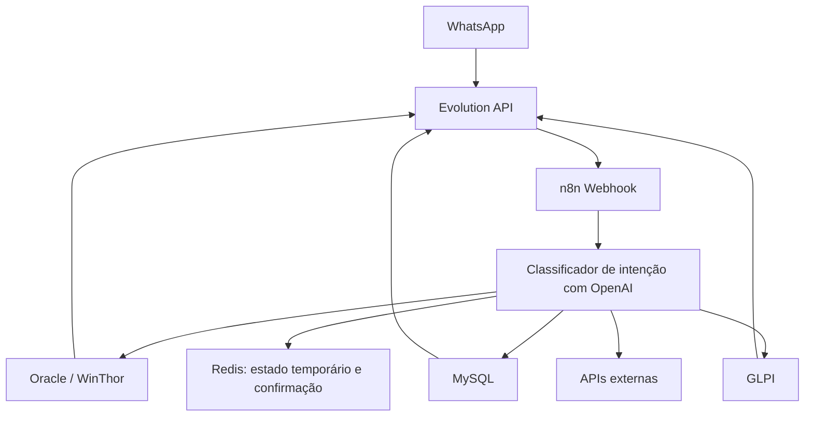

# Glados IT Automation

Assistente de automação de TI desenvolvido com n8n. O workflow recebe mensagens do WhatsApp via Evolution API, usa OpenAI para classificar intenções e integra serviços de atendimento, dados e operação.

## Integrações

- WhatsApp e Evolution API para receber e enviar mensagens.
- OpenAI para classificar intenções e extrair informações.
- Redis para controlar o estado temporário de conversas que aguardam confirmação.
- GLPI para abertura, resposta e atualização de chamados.
- MySQL para localizar usuários.
- Oracle/WinThor para consultar pedidos e estoque e apoiar operações de pedidos.

O workflow direciona solicitações sobre carregamento, rotinas do WinThor, derrubada de sessão, consulta e atualização de chamados, abertura de chamados, localização de usuários, liberação de pedidos e consulta de estoque. Há rotas desabilitadas mantidas para revisão futura.

## Arquivos

- `workflows/glados.json`: export do n8n sanitizado. URLs e identificadores de ambiente precisam ser configurados para cada implantação.
- `docs/`: arquitetura, intenções, integrações, segurança e melhorias futuras.
- `examples/mensagens.md`: exemplos sintéticos.
- `.env.example`: nomes de variáveis sugeridos, sem valores reais.

## Arquitetura

Consulte [docs/arquitetura.md](docs/arquitetura.md) e [docs/fluxo-intencoes.md](docs/fluxo-intencoes.md) para detalhes.

## Importação

1. Importe `workflows/glados.json` no n8n.
2. Configure as Credentials do ambiente no n8n e associe-as aos nodes correspondentes.
3. Substitua os valores `xxxxxxxxxxxxxxxxxxxx` pelos endpoints e parâmetros do ambiente.
4. Revise autorização, grupos e destinos antes de ativar o webhook.
5. Valide integrações em homologação antes de habilitar operações que alteram chamados ou pedidos.

O JSON preserva a estrutura e as conexões, mas exige reconfiguração e não deve ser ativado diretamente em produção.

## Projetos relacionados

[kb_glados_dti](https://github.com/Sipauba/kb_glados_dti) mantém a base de conhecimento do bot. Este repositório contém automação, orquestração e integrações; a base de conhecimento orienta quais informações o bot deve coletar do usuário. Mudanças nela podem alterar o comportamento do atendimento. Os projetos permanecem separados, mas têm dependência lógica entre si.

## Segurança

Mantenha Credentials no n8n ou em um gerenciador de segredos. Nunca versione `.env`, tokens, dados reais de clientes ou exports sem sanitização. Veja [docs/seguranca.md](docs/seguranca.md).

## Licença

Licença MIT. Consulte [LICENSE](LICENSE).
