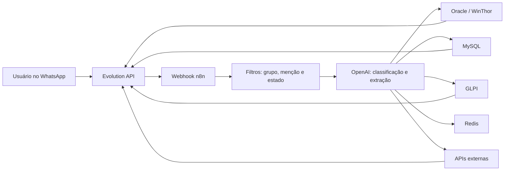

# Arquitetura

O workflow recebe eventos do WhatsApp por meio da Evolution API e do webhook do n8n. Após filtros de mensagem e contexto, nodes com OpenAI classificam a intenção e extraem dados para as rotas operacionais. As respostas retornam pela Evolution API.

O Redis guarda estado temporário associado a conversas que precisam de confirmação. O estado é consultado, criado e limpo pelos nodes do fluxo de pedidos, para tratar uma resposta posterior como continuação da etapa pendente.

Os endpoints foram substituídos por placeholders no export. Cada ambiente precisa configurar URLs, Credentials, destinos autorizados e parâmetros operacionais no n8n.
